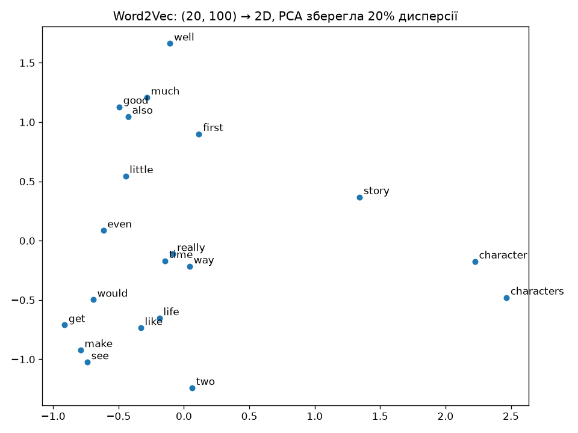

# Пари 31–32 · маршрут на 90 + 90 хвилин з повторенням пар 28–30

За два блоки по 90 хвилин ви згадаєте, що зробили на парах 28–30, і побудуєте карту вин: таблицю з 13 хімічними ознаками стиснете до двох осей так, щоб три сорти було видно на звичайному графіку.

| Блок | Час | Що робимо |
|---|---|---|
| **1** | 0:00–0:30 | Повторення: пара 28 → 29 → 30 і місток до нового модуля |
| | 0:30–1:30 | Пара 31 · SVD і зниження розмірності (практичне 7.1, завдання 1–2) |
| **2** | 0:00–1:30 | Пара 32 · PCA і порівняння з SVD (практичне 7.1, завдання 3–4) |

Час у кожному блоці йде від його початку. Усі команди запускайте **з кореня репозиторію** — з тієї папки, де лежить цей файл.

Докладний варіант лише пар 31–32 на 180 хвилин: [Lesson31_32_plan_180.md](PythonAI_Author_Lesson31_Lesson32/Lesson31_32_plan_180.md).

<a id="step-0"></a>
## Підготовка

Один спільний venv у корені (Python 3.10–3.14):

```text
python -m venv .venv
.venv\Scripts\activate          (Windows)
source .venv/bin/activate        (macOS / Linux)
python -m pip install -U pip
python -m pip install -r requirements.txt
```

Перевірка — три команди, по одній на кожну папку пар:

```bash
python PythonAI_Author_Lesson27_Lesson28/Lesson28_04_word_explorer.py good
python PythonAI_Author_Lesson29_Lesson30/Lesson30_04_supportflow_bot.py "how do i pay"
python PythonAI_Author_Lesson31_Lesson32/Lesson32_05_wine_map.py
```

- [ ] перша друкує таблицю сусідів слова `good`;
- [ ] друга друкує відповідь бота;
- [ ] третя друкує `на них 55.4% розкиду таблиці`.

Інтернет і GPU не потрібні. Графіки скрипти зберігають у папку `results/` своєї пари, вікна matplotlib не відкриваються.

---

# Блок 1 · 90 хвилин

<a id="step-1"></a>
## Крок 1 · 0:00–0:10 · Повторення пари 28: слово як 100 чисел

```bash
python PythonAI_Author_Lesson27_Lesson28/Lesson28_04_word_explorer.py good price
```

**Що побачите.** Word2Vec: `good → decent 0.73, sturdy 0.65, bad 0.65`. GloVe: `good → better 0.89`, `price → prices 0.86, value 0.76`.

Кожне слово — вектор зі 100 чисел. Слова, які вживають у схожих контекстах, мають близькі вектори; близькість міряємо косинусом.

**Зверніть увагу:** `bad` стоїть серед сусідів `good`. Вектор знає, що слова трапляються в однакових контекстах, а не що вони означають те саме.

```bash
python PythonAI_Author_Lesson27_Lesson28/Lesson28_02_similarity_pca.py
```

**Що побачите (~10 с).** Таблицю сусідів і два рисунки. Для Word2Vec: `матриця (20, 100), дві компоненти пояснюють 20% дисперсії`, для GloVe — 43%.



Сто чисел на слово стали двома — це зробив PCA. Запамʼятайте число 20%: наприкінці заняття ви знатимете, що воно означає і чому таке мале.

```bash
python PythonAI_Author_Lesson29_Lesson30/Lesson28_05_words_to_sequences.py
```

**Що побачите.** Пошуковик на середньому векторі запиту знаходить правильну відповідь для 11 з 15 перефразованих запитів. А ще `cos("you can cancel it", "can you cancel it") = 1.000`.

**Зверніть увагу:** середній вектор речення не бачить порядку слів. Ствердження і питання для нього однакові.

**Перевір себе:**
1. Вектор слова — це 100 чисел. Як слова опинилися на площині і яку частку розкиду при цьому втрачено?
2. Чому `cos("refund before delivery", "delivery before refund") = 1`?

<a id="step-2"></a>
## Крок 2 · 0:10–0:18 · Повторення пари 29: модель, що пише відповідь по слову

```bash
python PythonAI_Author_Lesson29_Lesson30/Lesson29_01_prepare_data.py
```

**Що побачите.** 15 пар «запит → відповідь», словник на 104 токени, з них 4 спеціальні. Нове слово `passcode` стає `<unk>=1`.

| Токен | Навіщо |
|---|---|
| `<pad>` | доповнити коротке речення до спільної довжини |
| `<unk>` | слово, якого немає у словнику |
| `<sos>` | «почни відповідь» |
| `<eos>` | «відповідь закінчено» |

Мовна модель робить одне: за словами, які вже є, вгадує наступне. Текст для неї — послідовність номерів зі словника.

```bash
python PythonAI_Author_Lesson29_Lesson30/Lesson29_03_train_rnn.py
```

**Що побачите (~7 с).** Після 10 епох loss 4.6 → 3.8, і на всі запити модель відповідає `you can the`. Після 150 епох — 100% дослівно правильних відповідей на навчальних запитах і 50% на перефразованих. На `i cannot remember my passcode` модель відповідає про відстеження замовлення.

RNN читає слова по одному і тримає стан — памʼять про прочитане. Seq2seq складається з двох таких мереж: енкодер стискає запит у вектор, декодер із нього пише відповідь.

**Перевір себе:**
3. Модель правильно відповіла на всі навчальні запити. Чому це ще не означає, що вона їх розуміє?

<a id="step-3"></a>
## Крок 3 · 0:18–0:26 · Повторення пари 30: три способи це полагодити

```bash
python PythonAI_Author_Lesson29_Lesson30/Lesson30_02_transfer_glove.py
```

Скрипт працює близько хвилини: навчає чотири варіанти моделі по три рази. Поки він рахує, згадайте три ідеї пари 30.

1. **LSTM.** Окрема лінія памʼяті та ворота: що забути, що записати, що показати. Памʼятає довше за просту RNN.
2. **Увага.** На кожному кроці модель сама вирішує, на які слова запиту дивитись. З неї виріс трансформер.
3. **Transfer learning.** Беремо шар, навчений на мільярдах слів, заморожуємо його і вчимо лише решту.

**Що побачите.**

| Варіант | Нові запити, дослівно |
|---|---|
| LSTM з нуля | 29% |
| LSTM + GloVe, заморожено | 53% |
| пошуковик з пари 28 | 73% |

У першому розділі виводу: `cash → money 0.85`, `need → want 0.87`. Модель з GloVe розуміє слова, яких не було в навчальних даних, бо їхні вектори лежать поруч зі знайомими.

```bash
python PythonAI_Author_Lesson29_Lesson30/Lesson30_04_supportflow_bot.py "i cannot remember my passcode" "my passcode" "i cannot remember"
```

**Що побачите.** На перші два запити бот відповідає про скидання пароля. На третій, без слова `passcode`, — про доставку.

**Зверніть увагу:** на 30 прикладах мову не вивчити. Знання приходять з великої готової моделі. А порівнювати моделі треба чесно: однакові умови і кілька запусків.

**Перевір себе:**
4. Слова `passcode` немає в навчальних даних. Звідки бот знає, що це про пароль?

<a id="step-4"></a>
## Крок 4 · 0:26–0:30 · Місток: від відповідей до будови даних

1. Досі завжди була правильна відповідь: ціна, діагноз, наступне слово. Модель вчилась на парах «вхід → відповідь». Це навчання з учителем.
2. Тепер відповіді немає. Є лише таблиця, і питання інше: як ці дані влаштовані? Це навчання без учителя, модуль 7.
3. Ви вже це робили на кроці 1: сто чисел на слово стали двома.
4. Сьогодні ви дізнаєтесь, як стиснути багато ознак у дві, втративши якомога менше, і як порахувати, скільки втрачено.

<a id="step-5"></a>
## Крок 5 · 0:30–0:36 · Пара 31 · готова карта вин

```bash
python PythonAI_Author_Lesson31_Lesson32/Lesson32_05_wine_map.py
python PythonAI_Author_Lesson31_Lesson32/Lesson32_05_wine_map.py --new alcohol=14.5 proline=1500 flavanoids=3.5
```

**Що побачите.** `178 вин, 13 ознак → 2 осі, на них 55.4% розкиду таблиці`. У вин №0, №70 і №150 усі пʼять найближчих сусідів — того самого сорту. Нове вино потрапляє в точку `PC1 = +1.58, PC2 = +1.77`, і сусіди підказують сорт 0.

Відкрийте `PythonAI_Author_Lesson31_Lesson32/results/wine_map.png`: три кольорові хмари майже не перетинаються.

**Зверніть увагу:** програма сортів не бачила. Кольори додано вже після обчислень.

<a id="step-6"></a>
## Крок 6 · 0:36–0:50 · Таблиця wine і StandardScaler (завдання 7.1.1)

У презентації 31: «Старт: навіщо стискати таблицю», «StandardScaler перед SVD», «Приклад · z-score на двох стовпцях».

```bash
python PythonAI_Author_Lesson31_Lesson32/Lesson31_01_prepare_wine.py
```

**Що побачите.** `DataFrame (178, 14)`: 13 ознак і `target`. Матриця ознак `(178, 13)`, сортів 59 / 71 / 48. `proline` змінюється від 278 до 1680, `hue` — від 0.48 до 1.71. Через це `proline` дає 99.8% усієї дисперсії таблиці. Після `StandardScaler` кожна ознака дає 7.7%.

z-score руками: `(x − mean) / std`. Для `proline[0] = 1065` це `(1065 − 746.9) / 314.0 = 1.013`, і scaler дає те саме.

**Зверніть увагу:** `target` лежить у `DataFrame`, але не в матриці `X`. Сорт потрібен лише для кольору точок.

**Перевір себе:**
5. Що зміниться в таблиці дисперсій, якщо `proline` записати не в міліграмах, а в грамах?
6. Чому 13 ознак не можна показати на одному графіку?

<a id="step-7"></a>
## Крок 7 · 0:50–1:05 · SVD-розклад руками

У презентації 31: «TruncatedSVD як дві нові осі», «Приклад · проєкція 4 точок на 2 компоненти».

```bash
python PythonAI_Author_Lesson31_Lesson32/Lesson31_02_svd_by_hand.py
```

**Що побачите.**
1. Таблицю 4 × 3 розкладено на `U`, `S = [10.06, 5.42, 1.14]` і `Vᵀ`. Добуток `U·S·Vᵀ` повертає таблицю.
2. Якщо лишити одне сингулярне число, похибка 5.54; якщо два — 1.14. Похибка дорівнює тому, що відкинули.
3. Для wine сингулярні числа `28.9, 21.1, 16.0, …`. Перші два тримають 36.2% і 19.2%.

| k | Частка | Похибка відновлення |
|---|---|---|
| 1 | 36.2% | 79.9% |
| 2 | 55.4% | 66.8% |
| 5 | 80.2% | 44.5% |
| 8 | 92.0% | 28.3% |
| 13 | 100% | 0% |

Перша вісь — суміш `flavanoids`, `total_phenols` і `od280/od315`. Друга — `color_intensity`, `alcohol` і `proline`.

**Часта пастка:** «дві компоненти» — це не два початкові стовпці. Кожна компонента складена з усіх 13 ознак з різними вагами.

**Перевір себе:**
7. Чому знак компоненти може бути іншим на іншому компʼютері і чи є це помилкою?
8. Чому за `k = 13` похибка дорівнює нулю?

<a id="step-8"></a>
## Крок 8 · 1:05–1:20 · TruncatedSVD і SVD Projection (завдання 7.1.2)

У презентації 31: «Приклад · wine у 2D», «Як читати scatter SVD Projection».

```bash
python PythonAI_Author_Lesson31_Lesson32/Lesson31_03_svd_projection.py
```

**Що побачите.** `TruncatedSVD(n_components=2)` перетворює `(178, 13)` на `(178, 2)`; `explained_variance_ratio_ = [0.362 0.192]`, разом 55.4%. Рисунки: `results/svd_projection.png` і `results/svd_scaled_vs_raw.png` (ліворуч без scaler, праворуч зі scaler).

| Дані | Точність kNN на координатах |
|---|---|
| 2 компоненти без scaler | 70.3% |
| 2 компоненти після scaler | 96.6% |
| усі 13 ознак після scaler | 95.5% |

**Зверніть увагу:** kNN тут — лінійка, якою ми міряємо якість карти. SVD сортів не бачив і нічого не класифікував.

**Напишіть самі.** Файл `PythonAI_Author_Lesson31_Lesson32/my_svd.py`:

```python
from pathlib import Path

import matplotlib

matplotlib.use("Agg")
import matplotlib.pyplot as plt
from sklearn.datasets import load_wine
from sklearn.decomposition import TruncatedSVD
from sklearn.preprocessing import StandardScaler

df = load_wine(as_frame=True).frame
print(df.shape)                                   # (178, 14)
X = df.drop(columns="target")                     # target не йде в SVD
X_scaled = StandardScaler().fit_transform(X)

svd = TruncatedSVD(n_components=2, random_state=42)
Z = svd.fit_transform(X_scaled)
print(Z.shape, svd.explained_variance_ratio_.round(3))   # (178, 2) [0.362 0.192]

plt.scatter(Z[:, 0], Z[:, 1], c=df["target"])
plt.xlabel("SVD-1")
plt.ylabel("SVD-2")
plt.title("SVD Projection")
plt.savefig(Path(__file__).parent / "results" / "my_svd_projection.png")
```

```bash
python PythonAI_Author_Lesson31_Lesson32/my_svd.py
```

Потім замініть `X_scaled` на `X` у `fit_transform`, запустіть ще раз і порівняйте рисунки.

**Перевір себе:**
9. Що буде з графіком, якщо масштабувати не до SVD, а після нього?

<a id="step-9"></a>
## Крок 9 · 1:20–1:26 · Навіщо саме TruncatedSVD

```bash
python PythonAI_Author_Lesson31_Lesson32/Lesson31_04_svd_text.py "i lost my password"
```

**Що побачите.** TF-IDF 30 запитів SupportFlow з кроку 3 — таблиця 30 × 107, де ненульових клітинок лише 5.1%. Якщо відняти середнє стовпців, ненульовими стануть усі 100%. Найближчий сусід має ту саму тему у 57% випадків на 107 числах, у 53% на 10 числах і лише у 20% на двох.

**Зверніть увагу:** `TruncatedSVD` даних не центрує, тому нулі лишаються нулями і велика таблиця текстів влазить у памʼять. Дві компоненти зручні для графіка, але для 12 тем їх замало: кількість компонент вибирають під задачу.

<a id="step-10"></a>
## Крок 10 · 1:26–1:30 · Перевір себе · пара 31

10. Навіщо зменшувати розмірність?
11. Чому scaler стоїть перед SVD?
12. Що повертає `fit_transform`?
13. Для чого на графіку колір `target`?

---

# Блок 2 · 90 хвилин

<a id="step-11"></a>
## Крок 11 · 0:00–0:05 · Повернення

Шлях пари 31: `DataFrame → X без target → StandardScaler → TruncatedSVD(2) → scatter`, і на двох осях лишилося 55.4% розкиду.

**Перевір себе:**
14. На кроці 1 PCA зберегла 20% розкиду 20 слів, а тут дві осі тримають 55.4%. Чому така різниця?

<a id="step-12"></a>
## Крок 12 · 0:05–0:20 · PCA і PCA Projection (завдання 7.1.3)

У презентації 32: «Старт: PCA як поворот осей», «Приклад · центр маси і нульове середнє», «PCA n_components=2».

PCA переносить початок координат у центр хмари точок і повертає осі так, щоб уздовж першої розкид був найбільший. Друга вісь перпендикулярна до першої і забирає найбільше з того, що лишилось.

```bash
python PythonAI_Author_Lesson31_Lesson32/Lesson32_01_pca_projection.py
```

**Що побачите.** `PCA(n_components=2)` дає ті самі `(178, 2)`. `PC1 36.2% + PC2 19.2% = 55.4%`; решти 44.6% розкиду на карті не видно. PC1 і PC2 не корелюють. PC1: `flavanoids +0.42`, `total_phenols +0.39`. PC2: `color_intensity +0.53`, `alcohol +0.48`. Рисунок — `results/pca_projection.png`, у підписах осей стоять частки дисперсії.

**Часта пастка:** номер компоненти — це не її частка. PC2 означає «друга за розкидом», а не «20%».

**Перевір себе:**
15. Дві осі зберігають 55.4% дисперсії. Чому сорти на карті все одно видно добре?

<a id="step-13"></a>
## Крок 13 · 0:20–0:37 · PCA руками і чим він відрізняється від SVD

У презентації 32: «Приклад · дві головні компоненти на toy-даних», «SVD vs PCA після scaler».

```bash
python PythonAI_Author_Lesson31_Lesson32/Lesson32_02_pca_by_hand.py
```

**Що побачите.**
1. PCA за три дії: відняти середнє → матриця коваріацій 13 × 13 → власні вектори. Власні числа `4.73, 2.51, 1.45, …`; їхні частки — це і є `explained_variance_ratio_`.
2. Координати збігаються з `sklearn.decomposition.PCA`.
3. Те саме дає SVD центрованої таблиці: `s² / (n − 1)` — ті самі власні числа.
4. На масштабованому wine `TruncatedSVD` і `PCA` відрізняються на `9.7e-09`: scaler уже відняв середнє.
5. Без scaler координати розходяться на 759. Перша вісь SVD майже збігається з вектором середніх (косинус 0.9998): вона показує, де лежить хмара відносно нуля, а не як вона розкидана.

**PCA = центрування + SVD.** Це головна формула пари.

**Перевір себе:**
16. Чому `PCA` після `StandardScaler` нічого не центрує вдруге?
17. Чому перша вісь SVD на нецентрованих даних «дивиться» на середнє?

<a id="step-14"></a>
## Крок 14 · 0:37–0:50 · SVD і PCA в одному вікні (завдання 7.1.4)

У презентації 32: «Приклад · дві панелі subplot», «Як читати схожі графіки».

```bash
python PythonAI_Author_Lesson31_Lesson32/Lesson32_03_svd_vs_pca.py --raw
```

**Що побачите.** `explained_variance_ratio_` обох моделей — `[0.362 0.1921]`, сума 0.5541. Рисунок `results/dimensionality_reduction_comparison.png`: верхній рядок — після scaler, нижній — без нього.

| Варіант | kNN на двох координатах |
|---|---|
| SVD після scaler | 96.6% |
| PCA після scaler | 96.6% |
| SVD без scaler | 70.3% |
| PCA без scaler | 69.1% |

PCA без scaler повідомляє, що дві компоненти пояснюють 99.98% дисперсії. Це дисперсія одного `proline`, а карта при цьому гірша.

**Зверніть увагу:** однакові графіки після scaler — не помилка. Дзеркальний графік теж не помилка: знак осі довільний.

**Напишіть самі.** Файл `PythonAI_Author_Lesson31_Lesson32/my_pca.py`:

```python
from pathlib import Path

import matplotlib

matplotlib.use("Agg")
import matplotlib.pyplot as plt
from sklearn.datasets import load_wine
from sklearn.decomposition import PCA, TruncatedSVD
from sklearn.preprocessing import StandardScaler

df = load_wine(as_frame=True).frame
X_scaled = StandardScaler().fit_transform(df.drop(columns="target"))

Z_svd = TruncatedSVD(n_components=2, random_state=42).fit_transform(X_scaled)
pca = PCA(n_components=2, random_state=42)
Z_pca = pca.fit_transform(X_scaled)
print(pca.explained_variance_ratio_.round(4), pca.explained_variance_ratio_.sum().round(4))

fig, axes = plt.subplots(1, 2, figsize=(11, 4.5))
for ax, Z, name in [(axes[0], Z_svd, "SVD"), (axes[1], Z_pca, "PCA")]:
    ax.scatter(Z[:, 0], Z[:, 1], c=df["target"])
    ax.set_title(f"{name} Projection")
    ax.set_xlabel(f"{name}-1")
    ax.set_ylabel(f"{name}-2")
fig.savefig(Path(__file__).parent / "results" / "my_comparison.png")
```

```bash
python PythonAI_Author_Lesson31_Lesson32/my_pca.py
```

Має надрукувати `[0.362  0.1921] 0.5541`.

**Зверніть увагу:** обидва алгоритми отримують один і той самий `X_scaled`. Якщо показуєте вікно через `plt.show()`, рисунок зберігайте до нього: після закриття вікна matplotlib збереже порожнє полотно.

**Перевір себе:**
18. Чому високе `explained_variance_ratio_` ще не означає, що карта добра?

<a id="step-15"></a>
## Крок 15 · 0:50–1:03 · Скільки компонент лишати

У презентації 32: «Додатково: скільки компонент лишати», «Додатково: scree plot».

```bash
python PythonAI_Author_Lesson31_Lesson32/Lesson32_04_how_many_components.py
```

**Що побачите.** Частки всіх 13 компонент і рисунок `results/scree_plot.png`. 80% дисперсії зберігають 5 компонент, 90% — 8, 95% — 10. `PCA(n_components=0.90)` сам вибирає 8.

PCA як крок перед класифікацією (`Pipeline`: scaler → PCA → LogisticRegression, 5-fold):

| Компонент | Точність |
|---|---|
| 1 | 84.8% |
| 2 | 95.5% |
| 3 | 96.6% |
| 5 | 97.8% |
| 13 | 98.3% |
| без PCA | 98.3% |

**Зверніть увагу:** scaler і PCA стоять усередині `Pipeline`, тому в кожному fold навчаються лише на train-частині. Якщо зробити `fit_transform` на всій таблиці до поділу, тестові рядки вплинуть на осі. Це leakage, як на парі 13.

**Перевір себе:**
19. Для нового вина викликають `transform`, а не `fit_transform`. Чому?
20. На wine PCA не підняв точність. Навіщо тоді зменшувати розмірність перед класифікацією?

<a id="step-16"></a>
## Крок 16 · 1:03–1:20 · Практика

[Lesson32_tasks.md](PythonAI_Author_Lesson31_Lesson32/Lesson32_tasks.md), завдання 2, пункти 1–3: вікно 2 × 2 зі `StandardScaler` і `MinMaxScaler`, найбільша різниця координат, таблиця.

Якщо важко — [Lesson31_tasks.md](PythonAI_Author_Lesson31_Lesson32/Lesson31_tasks.md), завдання 2, пункти 1–3 на wine.

Перед тим як показати результат, перевірте:
- [ ] у `X` немає стовпця `target`;
- [ ] обидва алгоритми отримали той самий масштабований `X`;
- [ ] надруковано `explained_variance_ratio_`;
- [ ] рисунок збережено у файл.

<a id="step-17"></a>
## Крок 17 · 1:20–1:30 · Перевір себе і підсумок

21. Що шукає PCA?
22. Чому порівняння SVD і PCA чесне лише на одному `X_scaled`?
23. Чому SVD і PCA можуть виглядати однаково?

**Підсумок.**
1. Зниження розмірності шукає кілька нових осей, які зберігають якомога більше розкиду таблиці. Відповіді (`target`) воно не бачить.
2. Перед SVD і PCA ознаки масштабують, інакше все вирішує стовпець з найбільшими числами.
3. SVD: `X = U·S·Vᵀ`; лишаємо `k` найбільших сингулярних чисел.
4. PCA = центрування + SVD. Після `StandardScaler` обидва алгоритми дають ту саму карту.
5. Кількість компонент вибирають під задачу: 2 для графіка, 90% дисперсії або найкраща точність — для моделі.

На парі 28 PCA була готовою кнопкою, яка зберегла 20% розкиду. Тепер ви знаєте, що це за кнопка і як порахувати втрату.

**Домашнє:** [Lesson31_homework.md](PythonAI_Author_Lesson31_Lesson32/Lesson31_homework.md), [Lesson32_homework.md](PythonAI_Author_Lesson31_Lesson32/Lesson32_homework.md).

**Наступна пара** — кластеризація K-Means: на цій самій карті алгоритм сам шукатиме групи, вже без кольорів-підказок.
